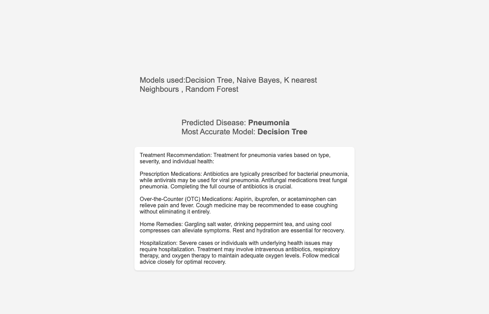
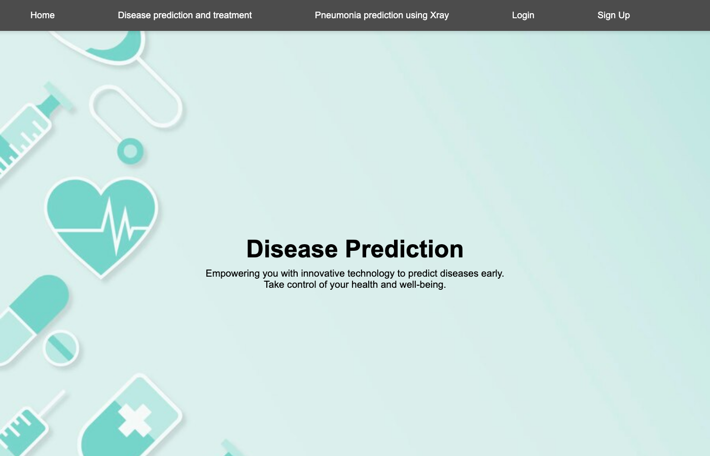
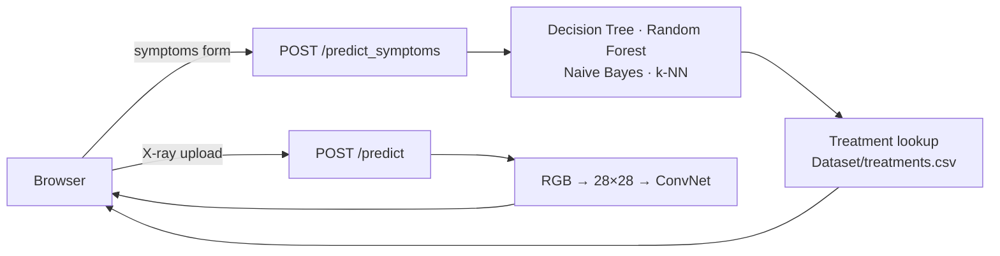

<div align="center">

# Disease Prediction and Pneumonia Detection

**What might these symptoms point to, and does this X-ray show pneumonia?**

A Flask web app with two diagnostic models. It predicts a likely disease from up to five symptoms with four classical classifiers, and it classifies chest X-rays as Normal or Pneumonia with a convolutional neural network.


[Quick start](#quick-start) · [How it works](#how-a-prediction-is-made) · [Limitations](#limitations)

</div>



> **Academic project. Not a medical device.** Predictions are for learning purposes only and are
> not diagnosis or treatment advice.

## Contents

- [What it does](#what-it-does)
- [See it work](#see-it-work)
- [How a prediction is made](#how-a-prediction-is-made)
- [Quick start](#quick-start)
- [Project structure](#project-structure)
- [Limitations](#limitations)
- [Team](#team)
- [Data credits](#data-credits)

## What it does

The app has two independent modules behind one interface.

**Symptom-based prediction**

1. **Select.** The user picks up to five symptoms from a list of 94.
2. **Classify.** Decision Tree, Random Forest, Naive Bayes and k-NN are trained on a binary symptom dataset covering 41 diseases.
3. **Pick a model.** The app reports the prediction of the model that scores best on its check.
4. **Recommend.** The predicted disease is looked up in `Dataset/treatments.csv` and the treatment guidance is shown.

**Chest X-ray classification**

1. **Upload.** The user uploads a `.jpg`, `.jpeg` or `.png` chest X-ray.
2. **Preprocess.** The image is converted to RGB and resized to 28 × 28.
3. **Classify.** A two-layer CNN returns `Normal` or `Pneumonia`.

## See it work

**1. Choose a module.** The home page links to symptom prediction and X-ray classification.



**2. Submit symptoms.** For example: chest pain, phlegm, mild fever, fast heart rate and rusty sputum.

**3. Read the result.** The app returns the disease, the model it came from and the treatment guidance (shown at the top of this page):

```text
Models used: Decision Tree, Naive Bayes, K nearest Neighbours, Random Forest
Predicted Disease: Pneumonia
Most Accurate Model: Decision Tree
Treatment Recommendation: Treatment for pneumonia varies based on type, severity, and individual health ...
```

**4. Or classify an X-ray** from the API directly:

```bash
curl -F "image=@chest_xray.jpeg" http://localhost:5000/predict
# {"prediction": "Pneumonia"}
```

## How a prediction is made



- **Symptoms become a feature vector.** Each of the 94 symptoms is a 0/1 column. Selected symptoms are set to 1.
- **Four classifiers vote separately.** Each one predicts a disease; the app shows the prediction of the best-scoring model.
- **The CNN** is 2 × [Conv 5×5, BatchNorm, ReLU, MaxPool 2×2] followed by one linear layer, trained for two epochs with Adam (learning rate 0.001). Weights ship in `model_xray_new.ckpt`.

| Route | Method | Returns |
| --- | --- | --- |
| `/` | GET | Home page with the symptom form |
| `/predict_symptoms` | POST | Result page with disease, model and treatment |
| `/xray` | GET | X-ray upload page |
| `/predict` | POST | JSON: `{"prediction": "Normal" \| "Pneumonia"}` |

## Quick start

Needs **Python 3.9+** and **git**.

```bash
git clone https://github.com/Akshayaamahesh/ML-based-disease-prediction-system.git
cd ML-based-disease-prediction-system
python3 -m venv venv && source venv/bin/activate
pip install -r requirements.txt
python app.py
```

Open <http://localhost:5000>. The trained CNN weights are included, so no download is needed.

<details>
<summary>Retraining the X-ray model</summary>

Download the [Kaggle Chest X-Ray Pneumonia](https://www.kaggle.com/datasets/paultimothymooney/chest-xray-pneumonia) dataset, set `train_path` and `test_path` in [`main.py`](main.py), then run:

```bash
python main.py
```

</details>

## Project structure

```
├── app.py               # Flask app: symptom and X-ray routes
├── model.py             # ConvNet definition, shared by the app and training
├── main.py              # CNN training script
├── model_xray_new.ckpt  # Trained CNN weights
├── Dataset/             # Symptom training and testing data, treatment mapping
├── templates/           # Jinja2 HTML templates
├── static/              # CSS, JavaScript, images
└── notebooks/           # Exploratory work
```

## Limitations

<details>
<summary>Show all limitations</summary>

- **Not clinically validated.** The symptom dataset and the X-ray model were built for coursework, not tested on clinical data.
- **Model selection is weak.** The "most accurate model" is chosen by comparing each prediction to a single test row, not by held-out accuracy. A proper version would select the model once, by cross-validation.
- **Classifiers retrain on every request.** All four models are refit each time the form is submitted. They should be trained once at startup or loaded from disk.
- **Low-resolution X-rays.** Images are downsampled to 28 × 28, which discards most of the detail a radiologist would use.
- **Short training.** The CNN was trained for two epochs. No test-set accuracy is reported in this repository.
- **Subset of symptoms.** The dataset has 132 symptom columns. The app uses 94 of them.
- **Login and Sign Up** links in the navigation are placeholders.

</details>

## Team

| Name |
| --- |
| Akshayaa M |
| Dhanya S |
| Prathibha G |
| Sreenithi S |

*PSG College of Technology.*

## Data credits

- Chest X-ray images: [Chest X-Ray Images (Pneumonia)](https://www.kaggle.com/datasets/paultimothymooney/chest-xray-pneumonia), Kermany et al., *Cell* 2018.
- Libraries: Flask, PyTorch, torchvision, scikit-learn, pandas, Pillow.
