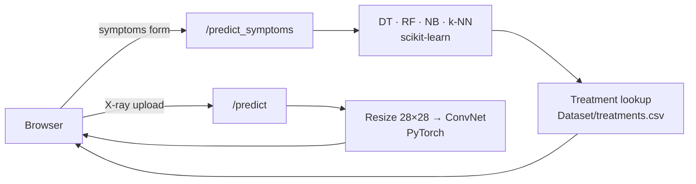

# ML-Based Disease Prediction & Pneumonia Detection


A Flask web application with two diagnostic modules:

1. **Symptom-based disease prediction** — the user selects up to five symptoms; four classifiers
   (Decision Tree, Random Forest, Naive Bayes, k-NN) are trained on a binary symptom dataset covering 41 diseases and the
   best-performing model's prediction is returned along with a recommended treatment.
2. **Chest X-ray pneumonia detection** — the user uploads an X-ray image, which is classified as
   *Normal* or *Pneumonia* by a two-layer convolutional neural network written in PyTorch.

> ⚠️ Academic project for learning purposes — not a medical device and not intended for clinical use.

## Architecture



**CNN (`model.py`)** — 2 × [Conv 5×5 → BatchNorm → ReLU → MaxPool] → Linear, trained on the
[Kaggle Chest X-Ray Pneumonia](https://www.kaggle.com/datasets/paultimothymooney/chest-xray-pneumonia) dataset.

## Quick Start

```bash
git clone https://github.com/Akshayaamahesh/ML-based-disease-prediction-system.git
cd ML-based-disease-prediction-system
python3 -m venv venv && source venv/bin/activate
pip install -r requirements.txt
python app.py
```

Open <http://localhost:5000>. The trained CNN weights (`model_xray_new.ckpt`) are included in the repo.

### Retraining the X-ray model

Download the chest X-ray dataset, update `train_path` / `test_path` in [`main.py`](main.py), then run:

```bash
python main.py
```

## Project Structure

```
├── app.py               # Flask app: routes for symptom and X-ray prediction
├── model.py             # ConvNet definition (shared by app and training)
├── main.py              # CNN training script
├── model_xray_new.ckpt  # Trained CNN weights
├── Dataset/             # Symptom training/testing data and treatment mapping
├── templates/           # Jinja2 HTML templates
├── static/              # CSS, JS, images
└── notebooks/           # Exploratory work
```

## Tech Stack

Python · Flask · PyTorch / torchvision · scikit-learn · pandas · Pillow · HTML / CSS / JavaScript

## Contributors

Akshayaa M · Dhanya S · Prathibha G · Sreenithi S — PSG College of Technology
